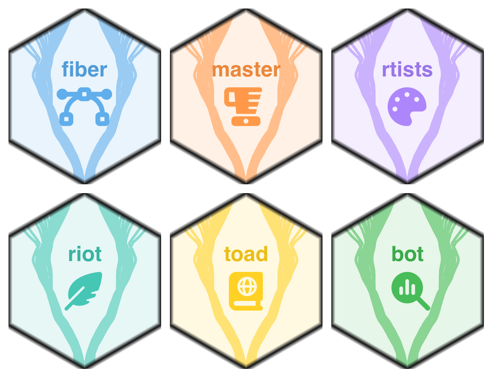

# tractoverse <a href="https://tractoverse.github.io/"></a>

<!-- badges: start -->

[](https://github.com/tractoverse/tractoverse/actions/workflows/R-CMD-check.yaml)
[](https://github.com/tractoverse/tractoverse/actions/workflows/pkgdown.yaml)
[](https://app.codecov.io/gh/tractoverse/tractoverse)
<!-- badges: end -->

The tractoverse is a curated collection of R packages for the analysis of
[diffusion MRI](https://en.wikipedia.org/wiki/Diffusion_MRI) tractography data,
inspired by the tidyverse. Installing this meta-package installs and, with
`library(tractoverse)`, attaches the whole family:

| Package | Role | Signature color |
|---------|------|-----------------|
| [fiber](https://tractoverse.github.io/fiber/) | Data structures (`streamline`, `bundle`, `bundle_set`) |  `#59aaea` |
| [master](https://tractoverse.github.io/master/) | Simulation of streamlines / bundles / bundle sets with microstructural parameters |  `#ff9441` |
| [rtists](https://tractoverse.github.io/rtists/) | Interactive 3D visualization |  `#a980fc` |
| [riot](https://tractoverse.github.io/riot/) | Data I/O (through `rvtk`) |  `#3ec4b2` |
| [toad](https://tractoverse.github.io/toad/) | Tractography Open Atlases Data (companion dataset package) |  `#ffcf1b` |
| [bot](https://tractoverse.github.io/bot/) | Bundle Optimal Transport; statistical methods for tractography data |  `#3fb950` |

The package also ships the shared tractoverse **brand** — the colors, theme
and logo family above — as the single source of truth reused by the individual
package websites and applications. See [tractoverse_brand()] and
[tractoverse_theme()].

## Installation

The core packages are released on CRAN when available and developed on GitHub
otherwise. The simplest way to bring in any selection of the family is
[install_core_packages()], which prefers the CRAN release and falls back to the
GitHub development branch:

``` r
# Default: install all six core packages
tractoverse::install_core_packages()

# …or just the ones you need, and force an upgrade
tractoverse::install_core_packages(c("fiber", "bot"), force = TRUE)
```

Once installed, load the whole family in one call:

``` r
library(tractoverse)
```

`library(tractoverse)` attaches the six core packages, so their functions
(`fiber::bundle()`, `master::simulate_bundle()`, …) are directly available, and
`tractoverse_packages()` lists the family.

## Quick start

``` r
library(tractoverse)

# The family, with each package's role
tractoverse_packages()

# Build a small bundle of streamlines with fiber
sl <- fiber::streamline(points = cbind(X = 0, Y = 0, Z = seq(0, 1, length.out = 5)))
fiber::bundle(list(sl))
```

## The shared brand

The tractoverse visual identity is defined once in
`inst/brand/_brand.yml` and mirrored as an R object:

``` r
tractoverse_brand()$palette
#   fiber   master   rtists     riot     toad      bot
# "#59aaea" "#ff9441" "#a980fc" "#3ec4b2" "#ffcf1b" "#3fb950"
```

[tractoverse_theme()] returns the path to the shared dark theme stylesheet for
tractoverse Quarto / pkgdown sites.

## Code of conduct

Please note that this project is released with a [Contributor Code of
Conduct](https://tractoverse.github.io/tractoverse/CODE_OF_CONDUCT.html). By
participating in this project you agree to abide by its terms.
